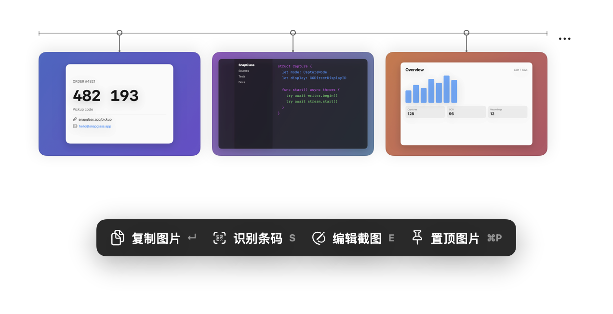
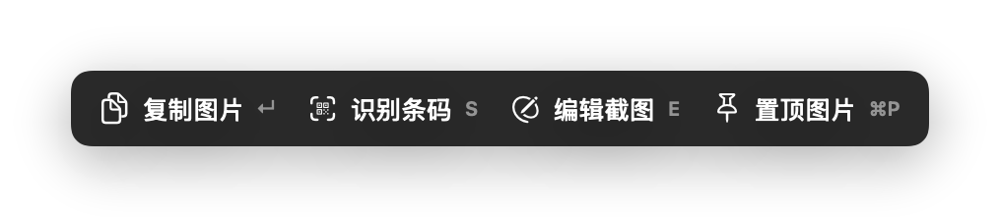
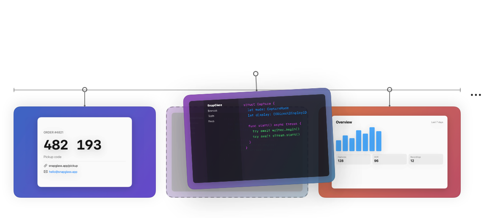
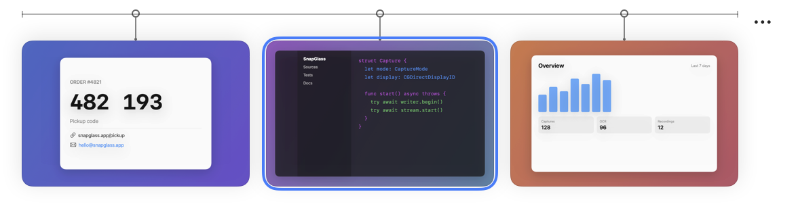
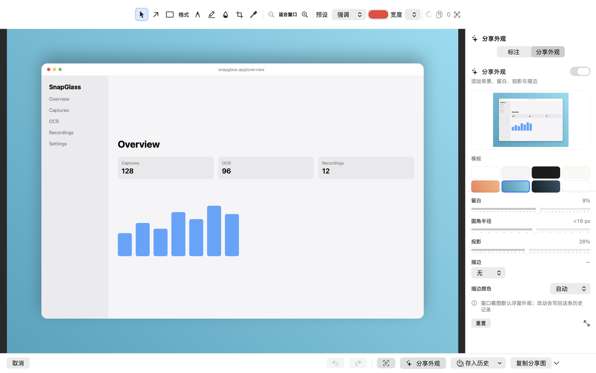
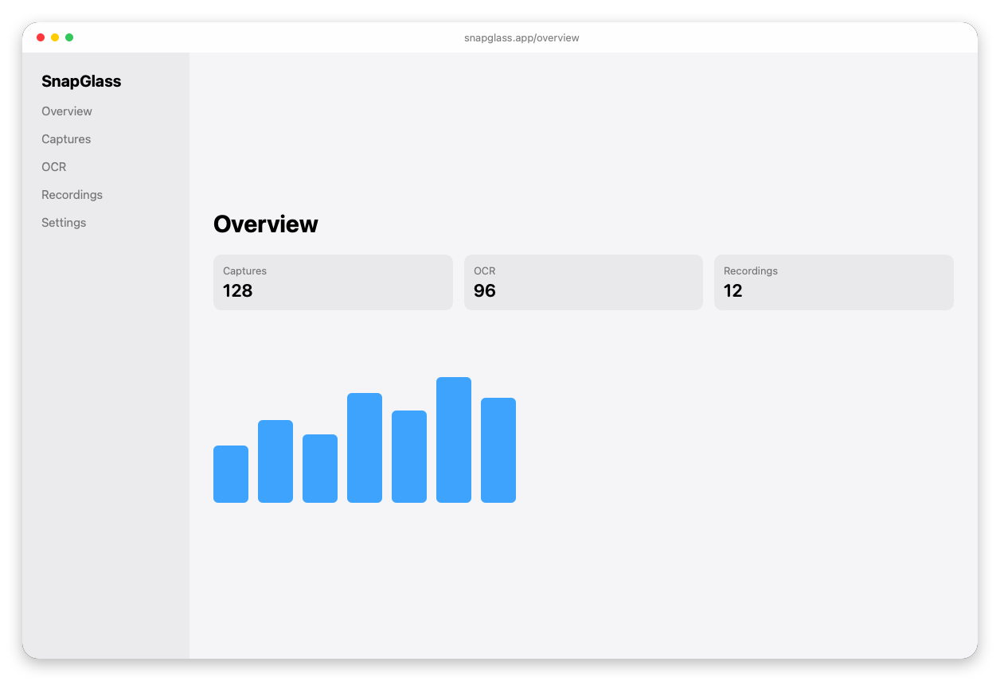
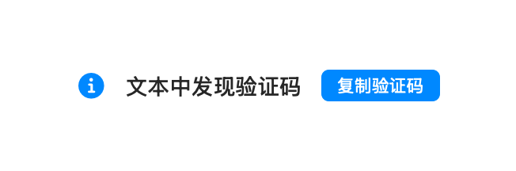
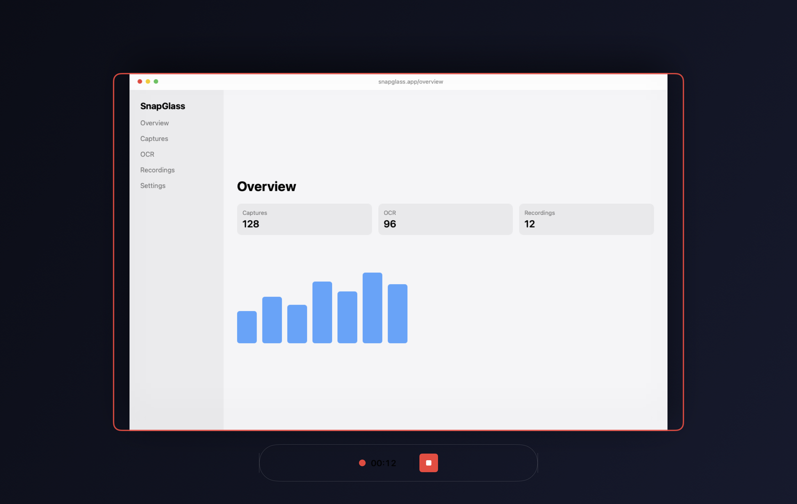

<h1 align="center">SnapGlass</h1>

<p align="center">
  <strong>Screenshots that go somewhere.</strong><br>
  <sub>Open-source screenshot, scrolling capture, OCR, barcode, screen &amp; audio recording for macOS.<br>Offline-first · No telemetry · On-device Apple Vision</sub>
</p>

<p align="center">
  <a href="README.md">简体中文</a> ·
  <a href="https://blackkcold.github.io/snapocr/en/">Website</a> ·
  <a href="https://github.com/blackkcold/snapocr/releases/latest">Download</a> ·
  <a href="CHANGELOG.md">Changelog</a> ·
  <a href="Docs/PRIVACY.md">Privacy</a>
</p>

<p align="center">
  <a href="https://github.com/blackkcold/snapocr/releases/latest">
    
  </a>
  <a href="https://github.com/blackkcold/snapocr/releases">
    
  </a>
  <a href="https://github.com/blackkcold/snapocr/actions">
    
  </a>
  <a href="LICENSE">
    
  </a>
  <a href="https://www.apple.com/macos/">
    
  </a>
  <a href="https://swift.org">
    
  </a>
</p>

<p align="center">
  <a href="https://github.com/blackkcold/snapocr/releases/latest">
    
  </a>
</p>

---

<p align="center">
  
</p>

<p align="center"><sub>Capture → the shot lands on the <strong>shelf</strong>, the action bar appears beside the selection → drag it into a chat or Finder. No folder hunting.</sub></p>

---

## Why SnapGlass

The system screenshot gives you an image. SnapGlass gives you a finished workflow:

- **Screenshot shelf**: recent shots wait at the edge of your screen. Reorder them, or drag one out as a real file straight into Finder, a browser upload area, WeChat / Feishu / Slack — no saving to the Desktop first.
- **OCR that takes the next step**: recognition runs on-device. When it finds a verification code, link, or email address, the banner offers "Copy code / Open link / Compose email" directly.
- **Share-ready look**: background, padding, corner radius, shadow, and stroke preview live on the editor canvas. What you copy is ready to post.
- **Your data stays here**: Apple Vision runs offline, history is encrypted with AES-256-GCM, and there is no telemetry or background upload.

---

## 30-second start

1. Download the DMG and drag **SnapGlass** into Applications.
2. If macOS blocks the first launch: **System Settings → Privacy & Security → Open Anyway**.
3. Grant **Screen Recording** — screenshots, scrolling capture, screen recording, and system audio depend on it.
4. Press <kbd>⌘</kbd>+<kbd>⇧</kbd>+<kbd>1</kbd> and drag a region. On mouse-up, the action bar offers copy, edit, pin, and barcode recognition.

> **Try it**: drag [`Docs/demo/ocr-sample.png`](Docs/demo/ocr-sample.png) into SnapGlass. It contains a pickup code, a link, and an email address; OCR should offer "Copy verification code" and friends.

<p align="center">
  
</p>

<p align="center"><sub>The action bar after a selection: four common destinations, each with a shortcut.</sub></p>

---

## What's new in v1.7

### Share appearance, steadier recording

- **Share appearance in the editor**: background templates, padding, corner radius, shadow, and stroke; live canvas preview; copy as a share-ready image or the original.
- **Recording stability**: fixed a stuck countdown, leftover HUD panels, unreadable recordings when system audio ended a few milliseconds early, and a first-second freeze. Watchdogs now stop and save when the UI stops responding.
- **Four languages**: Simplified Chinese, English, Japanese, Korean.

See the [CHANGELOG](CHANGELOG.md) for the full list.

---

## Features

### Capture and scrolling capture

- Rectangular region, freeform lasso, window, full screen, all displays, and manual scrolling capture — primarily on ScreenCaptureKit.
- Live crosshair; the action bar appears on mouse-up, while the selection stays movable, resizable in eight directions, and nudgeable with arrow keys.
- Multi-display and mixed scaling; Retina pixels by default, optional 1x.
- PNG / JPEG output with adjustable JPEG quality; transparency forces PNG.
- **Scrolling capture**: pick a window or region, scroll, then choose "Capture Next Scroll Frame". If nothing changed, SnapGlass asks you to scroll again; at the size limit you can finish and keep what was captured.
- **All-display capture**: compact horizontal / vertical or physical arrangement, 0–64 pt gap, merged into one image or one per display.

### The shelf

Recent screenshots wait at the screen edge in completion order:

- **Reorder**: drag left or right inside the shelf, release to drop.
- **Drag out as a file**: dragging a card out of the shelf becomes a native file drag for Finder, browser upload areas, and chat apps.
- **Keyboard mode**: <kbd>←</kbd><kbd>→</kbd> select, <kbd>↵</kbd> copy, <kbd>Space</kbd> edit, <kbd>⌘</kbd>+<kbd>S</kbd> save as, <kbd>⌫</kbd> remove, <kbd>Esc</kbd> exit.
- **Follows your pointer across displays**, collapses to a slim handle when idle, and offers adjustable count, card height, opacity, and edge position.
- <kbd>⌘</kbd>+<kbd>B</kbd> opens the share-appearance panel; <kbd>⇧</kbd>+<kbd>B</kbd> switches templates.

<p align="center">
  
</p>

<p align="center"><sub>Reordering inside the shelf; drag a card out and it becomes a native file drag.</sub></p>

<p align="center">
  
</p>

<p align="center"><sub>Keyboard mode: arrows to select, Return to copy, Space to edit.</sub></p>

### Annotation editor and share appearance

- Eight tools: arrow, rectangle, text, pen, highlight, blur, crop, color picker.
- Full undo / redo; rectangles are outlined by default and can be filled explicitly.
- With the selection tool, select OCR text directly, copy it, or turn it into an annotation.
- Crop supports move, resize, and confirm.
- Color picker shows hex and RGB on hover; click copies one color, drag samples the average and dominant colors; color history lives in the History window's "Colors" grid with hex filtering.
- **Share appearance**: background templates, padding, corner radius, shadow, stroke width and color; the canvas draws it live; export preview and large preview; the copy menu separates "share image" from "original".
- <kbd>⌘</kbd>+<kbd>1</kbd> returns to 1:1 image pixels; zoom keeps the point under the cursor.

<p align="center">
  
</p>

<p align="center"><sub>Share appearance previews live on the canvas; adjust the background, padding, radius, shadow, and stroke.</sub></p>

### Window capture styling

Window captures get **rounded corners and a soft shadow** by default, so pasting into a document or chat looks finished without opening an editor.

- Shadow and radius scale with the display.
- Can be disabled in **Settings → Capture → Image**.
- Window captures only; region, full-screen, and scrolling captures keep their original pixels.

<p align="center">
  
</p>

<p align="center"><sub>Window captures come with rounded corners and a shadow.</sub></p>

### OCR and smart actions

- Apple Vision recognition, fully offline; very large images are tiled and coordinates merged.
- Developer mode can compare Vision and Tesseract side by side.
- One-click copy; enabling "store complete OCR text" makes history full-text searchable.
- **Smart actions**: when the text contains a link, email address, or six-digit code, the banner offers "Open / Compose email / Copy code" without manual selection.

<p align="center">
  
</p>

<p align="center"><sub>A verification code, link, or email address gets a direct action.</sub></p>

### Barcodes and QR codes

- QR / Code128 / EAN / PDF417 / Aztec / DataMatrix.
- Press <kbd>S</kbd> in the selection action bar to scan without opening the editor or writing history.
- The result overlay copies one or all codes and opens http(s) links; <kbd>R</kbd> recaptures for animated codes.
- Optional automatic detection after a capture, with one-click copy.

### Pin

- <kbd>⌘</kbd>+<kbd>P</kbd> during selection, or "Pin Image" in the action bar.
- Drag to move; resize from the bottom-right corner; scroll or pinch to zoom; <kbd>⌥</kbd>+scroll for opacity.
- Hover toolbar: opacity, logarithmic zoom (10%–800%), 1:1, and fit-to-screen.
- Right-click to copy the image, copy text (OCR), fit to screen, or close all.
- Double-click, <kbd>Esc</kbd>, or <kbd>⌘</kbd>+<kbd>W</kbd> closes; pinned content is excluded from recordings and later captures.

### Screen and audio recording

- **Screen recording**: one display, one window, or a region; optional system audio; MP4 output.
- **Audio recording**: system sound, microphone, or both; single-track mix or per-source tracks; M4A output.
- **Atomic publish**: write to a temporary file, move into place only on success, never overwrite an existing file with the same name.
- **Recording HUD**: separate states for countdown, elapsed time, saving, failure, and "no frames received"; adjustable opacity, hover restore, recording border, and reveal in Finder when done.
- **Recoverable**: a checkpoint every 10 seconds, so a crash loses at most about 10 seconds; each segment tops out at 59 minutes; failed or cancelled material can be registered for recovery.
- **No infinite recording**: first-frame, first-sample, and audio-liveness leases plus a main-thread watchdog stop and save when the UI stops responding.
- The menu bar shows a static recording indicator; quitting asks about unsaved recordings.

<p align="center">
  
</p>

<p align="center"><sub>The recording frame stays out of the capture; the capsule shows elapsed time and stop.</sub></p>

> [!NOTE]
> Recording output and recovery media are **not encrypted**. Choose the output folder with that in mind and manage sync or backup yourself.

### History and privacy

- History is encrypted locally with **AES-256-GCM**; the key stays on this Mac in a `0600` file.
- Default retention: screenshots 7 days / 100 items; OCR text 30 days / 500 items; thumbnails 90 days / 1000 items.
- Complete OCR text is **not stored by default**; history export can redact emails, phone numbers, and ID numbers.
- No background network requests. SnapGlass only connects when you check for updates, download a Tesseract language pack, or explicitly enable automatic update checks (at most once a day).
- No keychain access, no telemetry; pinned panels live in memory and are excluded from recordings and later captures.

---

## Use cases

- Extract text from **PDFs with no selectable text**, shared screens in video calls, or online courses.
- **Annotate a screenshot** and send it to a group, or **style a window capture** for a document.
- Scan a **QR code or barcode** from the screen and open its link.
- **Drag recent screenshots into a chat** without saving them to the Desktop first.
- Keep a long article, chat log, or code diff with **scrolling capture**.
- Record a demo with **screen + system audio**, or capture meeting notes with **audio recording**.

---

## Shortcuts

| Action | Shortcut |
|--------|----------|
| Region capture | <kbd>⌘</kbd> + <kbd>⇧</kbd> + <kbd>1</kbd> |
| Window capture | <kbd>⌘</kbd> + <kbd>⇧</kbd> + <kbd>2</kbd> |
| Full-screen capture | <kbd>⌘</kbd> + <kbd>⇧</kbd> + <kbd>3</kbd> |
| OCR | <kbd>⌘</kbd> + <kbd>⇧</kbd> + <kbd>O</kbd> |
| Pin current selection | <kbd>⌘</kbd> + <kbd>P</kbd> |
| Scan barcode in selection | <kbd>S</kbd> |
| Recapture barcode | <kbd>R</kbd> |
| Shelf share appearance | <kbd>⌘</kbd> + <kbd>B</kbd> |
| Cycle share-appearance templates | <kbd>⇧</kbd> + <kbd>B</kbd> |

Shelf keyboard mode (enable it from the shelf menu):

| Action | Key |
|--------|-----|
| Previous / next item | <kbd>←</kbd> / <kbd>→</kbd> |
| Copy | <kbd>↵</kbd> |
| Open editor | <kbd>Space</kbd> |
| Save as | <kbd>⌘</kbd> + <kbd>S</kbd> |
| Remove | <kbd>⌫</kbd> |
| Exit keyboard mode | <kbd>Esc</kbd> |

Global capture and OCR shortcuts are configurable in **Settings → Shortcuts**. Pin is a selection-context shortcut, not a global hotkey. Audio recording has no default shortcut; assign one in Settings.

---

## Download, verify, update

Get the latest build from [Releases](https://github.com/blackkcold/snapocr/releases/latest):

| File | Purpose |
|------|---------|
| `SnapGlass-vX.Y.Z.dmg` | Installer (Universal: Apple Silicon + Intel, about 16.6 MB) |
| `SnapGlass-vX.Y.Z.dmg.sha256` | SHA-256 checksum |
| `appcast.xml` | Sparkle update feed; the app reads it automatically |

```bash
# Verify the downloaded DMG
shasum -a 256 -c SnapGlass-v1.7.2.dmg.sha256
```

> [!WARNING]
> SnapGlass uses a fixed self-signed certificate, not an Apple Developer ID, so the first launch needs approval in **System Settings → Privacy & Security**.
> The fixed identity lets later versions update in place through Sparkle without repeating that step. Upgrading from 1.4.x to 1.5.0 resets Screen Recording permission once.
> Screenshots, scrolling capture, screen recording, and system audio all need Screen Recording permission.

---

## FAQ

<details>
<summary><strong>macOS says it cannot verify the developer. What do I do?</strong></summary>

Open **System Settings → Privacy & Security**, click **Open Anyway** in the security section, and confirm. SnapGlass has no Apple Developer ID; this is the normal first-run flow for a self-signed app. The fixed certificate means later automatic updates do not repeat it.

</details>

<details>
<summary><strong>Which permissions does it need?</strong></summary>

- **Screen Recording**: screenshots, scrolling capture, screen recording, and system audio.
- **Microphone**: only when the microphone is selected as an audio source.

Denying a permission disables only the related feature.

</details>

<details>
<summary><strong>Are my screenshots or text uploaded?</strong></summary>

No. Capture uses ScreenCaptureKit locally, OCR uses Apple Vision on-device, and barcodes use the local Vision barcode framework. There is no telemetry and no background network request.

The app connects only when you check for updates, download a Tesseract language pack, or explicitly enable automatic update checks (at most once a day). Update packages and the feed are verified with EdDSA signatures.

</details>

<details>
<summary><strong>Where are history and recordings stored?</strong></summary>

- Screenshots: `~/Library/Application Support/SnapGlass/History/v2/images/` (AES-256-GCM)
- OCR text: `~/Library/Application Support/SnapGlass/History/v2/entries/` (AES-256-GCM)
- Thumbnails: `~/Library/Application Support/SnapGlass/History/v2/thumbs/` (unencrypted)
- History key: `~/Library/Application Support/SnapGlass/Security/history-v2.key` (`0600`)
- Screen / audio recordings: the folder you choose in Settings (**unencrypted**)
- Crash logs: `~/Library/Logs/SnapGlass/`

See the [Privacy Statement](Docs/PRIVACY.md) for details.

</details>

<details>
<summary><strong>Does it run on Intel Macs?</strong></summary>

Yes. Releases are Universal binaries (arm64 + x86_64) and require macOS 13.0 or later. macOS 26 and later automatically use Liquid Glass; older versions fall back gracefully.

</details>

<details>
<summary><strong>Which languages are supported?</strong></summary>

Simplified Chinese, English, Japanese, and Korean. The UI follows the system language.

</details>

<details>
<summary><strong>How do I uninstall it completely?</strong></summary>

1. Quit SnapGlass and move `SnapGlass.app` to the Trash.
2. To remove local data, delete `~/Library/Application Support/SnapGlass/`, `~/Library/Preferences/com.snapglass.app.plist`, and `~/Library/Logs/SnapGlass/`.
3. Screen and audio recordings live in the folder you chose; delete them separately.
4. Remove SnapGlass from **System Settings → Privacy & Security → Screen Recording / Microphone** if you no longer use it.

</details>

<details>
<summary><strong>How do automatic updates work?</strong></summary>

SnapGlass uses Sparkle 2 to read `appcast.xml`; both the feed and the update package are verified with EdDSA signatures. Manual checks are allowed by default; automatic checking and automatic installation must be enabled explicitly. Installation is postponed while annotations are unsaved or a recording is running.

</details>

<details>
<summary><strong>Why is there no audio in my screen recording?</strong></summary>

Check that the recording source is a display, window, or region and that system audio is enabled; system audio needs Screen Recording permission. If system audio fails to start, SnapGlass keeps recording video and tells you after saving that the video was saved without system audio, rather than discarding the whole recording.

</details>

<details>
<summary><strong>How is this different from the system screenshot tool?</strong></summary>

If you only need a capture that lands on the clipboard, the system tool is enough. Use SnapGlass when you want the **shelf workflow, scrolling capture, OCR with next-step actions, share appearance, or screen/audio recording**. They coexist without shortcut conflicts.

</details>

---

## Requirements

- macOS 13.0+
- Universal binary (Apple Silicon / Intel)
- Screen Recording permission for capture, scrolling capture, screen recording, and system audio
- Building requires Xcode 16+ and Swift 6.0

---

## Build from source

<details>
<summary>Expand: local build, tests, and project layout</summary>

```bash
# Build tools
brew install xcodegen swiftlint

# Generate the Xcode project
xcodegen generate

# Release build signed with the fixed certificate
./scripts/build.sh --version 1.7.2 --sign

# Local debug build (ad-hoc, no auto-update)
./scripts/build.sh --no-sign

# Experimental local package: a unique directory every time, never overwritten
./scripts/build.sh --experimental

# Reveal the product in Finder (output goes to release/vX.Y.Z/)
./scripts/build.sh --open

# Run the full test suite
./scripts/test.sh
```

Products are archived under `release/vX.Y.Z/`; there is no `output/` directory. See [`Docs/RELEASE.md`](Docs/RELEASE.md).

```
SnapGlass/
├── App/SnapGlass/           # macOS GUI app
├── Packages/                # Core modules (SPM)
│   ├── SharedKit/            # Preferences, image encoding, crypto, logging
│   ├── CaptureCore/          # Capture, screen and audio recording
│   ├── OCRCore/              # OCR (Vision + Tesseract fallback)
│   ├── BarcodeCore/          # Barcode recognition
│   ├── AnnotationCore/       # Annotation tools
│   ├── ScrollCore/           # Scrolling capture stitching
│   ├── HistoryCore/          # Encrypted local history
│   └── AutomationCore/       # Automation source, not in the product build
├── Docs/                     # Documentation
├── scripts/                  # Build and test scripts
└── release/                  # Release archives
```

</details>

---

## Documentation

| Document | Contents |
|----------|----------|
| [Architecture](Docs/ARCHITECTURE.md) | Protocol layers and module design |
| [Privacy](Docs/PRIVACY.md) | Data handling and privacy |
| [Security](Docs/SECURITY.md) | Security boundaries and vulnerability reporting |
| [Contributing](Docs/CONTRIBUTING.md) | Code style and pull requests |
| [Release](Docs/RELEASE.md) | Build and release process |
| [Testing](Docs/TESTING.md) | Test layers, offscreen canvas rendering, agent scenarios |
| [CI](Docs/CI.md) | GitHub Actions workflows |
| [Changelog](CHANGELOG.md) | Version history |

---

## Contributing

Contributions are welcome. Please read the [Contributing Guide](Docs/CONTRIBUTING.md) first.

- **Pull requests**: follow [Conventional Commits](https://www.conventionalcommits.org/)
- **Bug reports**: use [GitHub Issues](https://github.com/blackkcold/snapocr/issues)
- **Security issues**: report privately through GitHub Issues, not in public

---

## License

[MIT License](LICENSE) © SnapGlass Contributors
