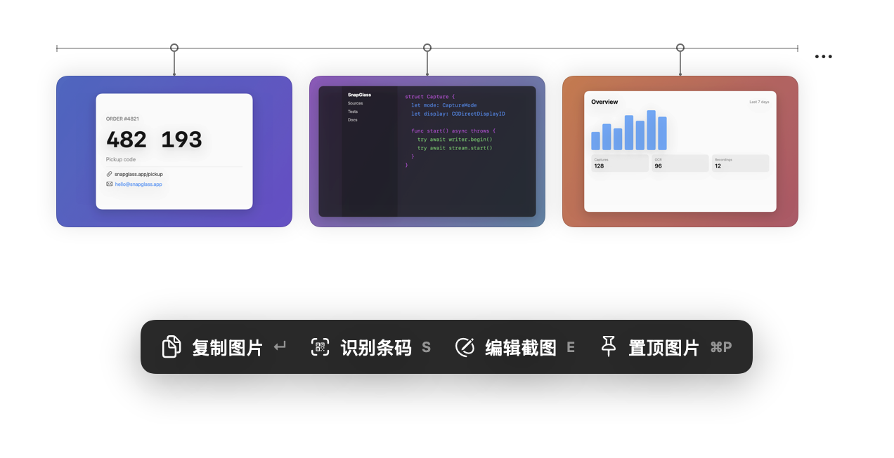
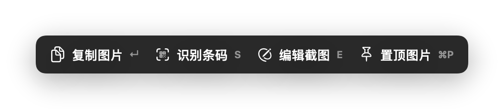
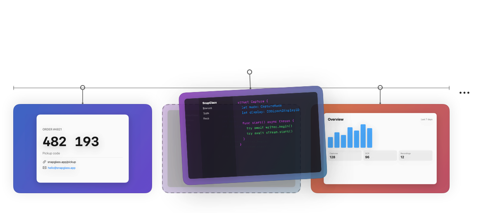
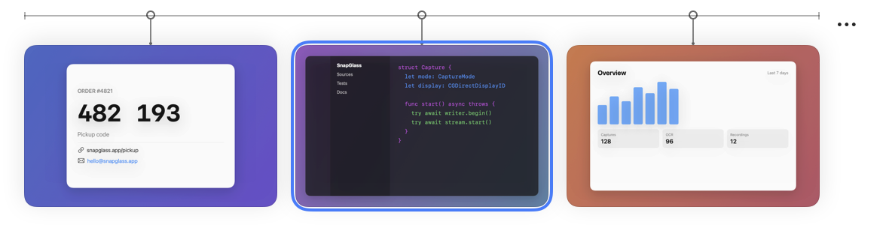
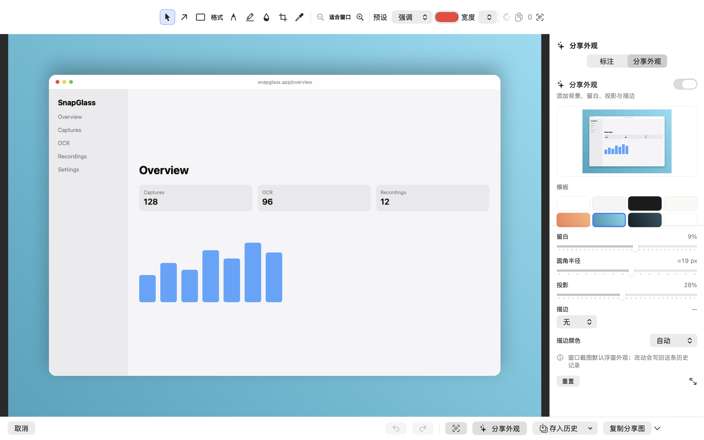
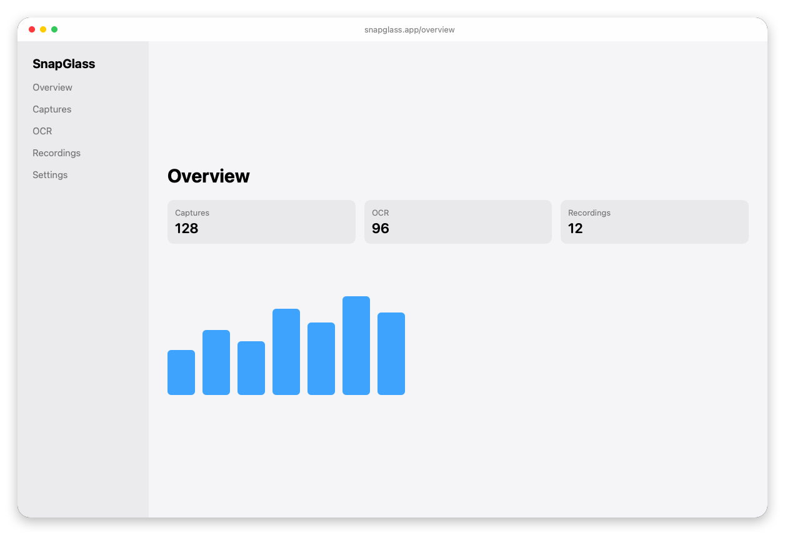
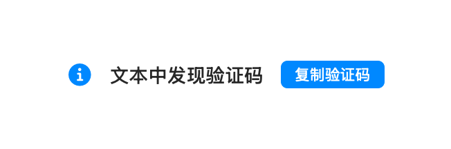
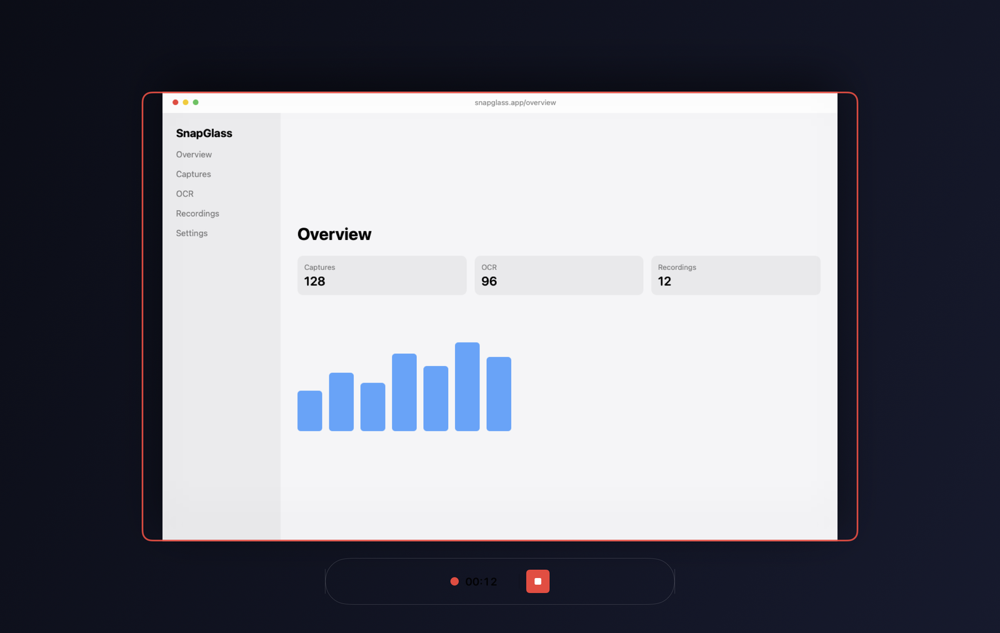

<h1 align="center">SnapGlass</h1>

<p align="center">
  <strong>截图之后，不用再找文件。</strong><br>
  <sub>macOS 开源截图 · 滚动截图 · OCR · 条码 · 录屏与录音<br>离线优先 · 无遥测 · Apple Vision 本地识别</sub>
</p>

<p align="center">
  <a href="README.en.md">English</a> ·
  <a href="https://blackkcold.github.io/snapocr/">官网</a> ·
  <a href="https://github.com/blackkcold/snapocr/releases/latest">下载</a> ·
  <a href="CHANGELOG.md">更新日志</a> ·
  <a href="Docs/PRIVACY.md">隐私</a>
</p>

<p align="center">
  <a href="https://github.com/blackkcold/snapocr/releases/latest">
    
  </a>
  <a href="https://github.com/blackkcold/snapocr/releases">
    
  </a>
  <a href="https://github.com/blackkcold/snapocr/actions">
    
  </a>
  <a href="LICENSE">
    
  </a>
  <a href="https://www.apple.com/macos/">
    
  </a>
  <a href="https://swift.org">
    
  </a>
</p>

<p align="center">
  <a href="https://github.com/blackkcold/snapocr/releases/latest">
    
  </a>
</p>

---

<p align="center">
  
</p>

<p align="center"><sub>截图完成 → 挂上<strong>截图架</strong>，选区旁出现动作栏 → 拖进聊天窗口或 Finder，整个过程不用打开文件夹。</sub></p>

---

## 为什么是 SnapGlass

系统截图给你一张图片，SnapGlass 给你一条完成后的工作流：

- **截图架**：最近几张截图挂在屏幕边缘。拖动排序，拖出架体就是一个真实文件——直接落进 Finder、浏览器上传区、微信 / 飞书 / Slack，不用先保存到桌面。
- **识别完就能办事**：OCR 在本机跑。识别到验证码、链接或邮箱时，提示条直接给出「复制验证码 / 打开链接 / 发邮件」。
- **分享外观**：背景、留白、圆角、投影、描边在编辑器里实时预览；复制出去就是一张能直接发的图。
- **数据不离开本机**：Apple Vision 离线识别，历史记录 AES-256-GCM 加密，没有遥测，没有后台上传。

---

## 30 秒上手

1. 下载 DMG，把 **SnapGlass** 拖进「应用程序」。
2. 首次打开若被系统拦截：**系统设置 → 隐私与安全性 → 仍要打开**。
3. 授予「**屏幕录制**」权限——截图、滚动截图、录屏和系统声音都依赖它。
4. 按 <kbd>⌘</kbd>+<kbd>⇧</kbd>+<kbd>1</kbd> 框选；松开鼠标后，动作栏会给出复制、编辑、置顶、识别条码等去向。

> **试一试**：把 [`Docs/demo/ocr-sample.png`](Docs/demo/ocr-sample.png) 拖进 SnapGlass。图里有一个取件码、一个链接和一个邮箱，识别后应该直接出现「复制验证码」等动作。

<p align="center">
  
</p>

<p align="center"><sub>选区松手后出现的动作栏，四个常用去向都带快捷键。</sub></p>

---

## 这次更新了什么

### v1.9 · 双击之后，不再是「什么都没发生」

- **四页欢迎引导**：第一次启动就会看到——图标在菜单栏的位置、当场可录的快捷键、截图之后去哪、录屏需要什么权限。页码可跳转，`←`/`→` 切页，`Return` 前进；按 `Esc` 或红叉关闭不算完成，下次启动从原页继续。
- **Dock 三档**：有窗口时 / 始终 / 从不。首启复选框与「设置 → 通用 → 程序坞」两处都能改，改完立即生效。
- **菜单栏 coach**：引导窗关掉后指出图标在哪。屏幕放不下时按可用空间降级——完整浮层、单行条、屏幕中央卡片，最后是无障碍播报，不会静默消失。
- **快捷键冲突检测**：App 内重复、macOS 保留组合、以及用 Carbon 实际试注册一次。冲突立刻显示徽章与说明，而不是「设上了却按了没反应」。
- **再次双击 App 不再静默**：按当前状态恢复录制控制条、重开未完成的引导、前置已有窗口，或打开偏好设置。
- **权限授予后的三步教程**：菜单栏提示按快捷键 → 编辑器底部横幅 → 截图架顶部拖拽提示，一步接一步。

完整修复列表见 [CHANGELOG](CHANGELOG.md)。

---

## 功能

### 截图与滚动截图

- 矩形区域、自由圈选、窗口、全屏、所有显示器、手动滚动截图，主路径基于 ScreenCaptureKit。
- 选区实时十字准线；松开鼠标即出动作栏，选区仍可拖动、八向缩放、方向键微调。
- 支持多显示器与混合缩放；默认 Retina 像素，可切换标准 1x。
- 输出 PNG / JPEG，JPEG 质量可调；透明内容强制 PNG。
- **滚动截图**：选窗口或区域后逐帧采集，滚动窗口再点「截取下一帧」；画面没变化会提示重试，达到尺寸上限时结束拼接会保留已采集部分。
- **所有显示器截图**：紧凑横向 / 纵向或按物理排列，间隙 0–64pt，可合并一张或每屏一张。

### 截图架：截图之后不用找文件

最近截图按完成顺序挂在屏幕边缘，随时取用：

- **拖动排序**：架内左右拖动即改变顺序，松手落位。
- **拖出成文件**：把卡片拖出架体，立刻变成系统文件拖拽，可直接落进 Finder、浏览器上传区、微信 / 飞书 / Slack 等聊天窗口。
- **键盘模式**：<kbd>←</kbd><kbd>→</kbd> 选择、<kbd>↵</kbd> 复制、<kbd>空格</kbd> 进编辑器、<kbd>⌘</kbd>+<kbd>S</kbd> 另存为、<kbd>⌫</kbd> 移除、<kbd>Esc</kbd> 退出。
- **跨屏跟随**：指针切到另一块显示器并短暂停留，截图架会淡出 / 淡入跟随。
- **不挡路**：空闲时缩成一条细把手，指针停留才展开；可调数量、卡片高度、透明度、贴边位置。
- <kbd>⌘</kbd>+<kbd>B</kbd> 打开分享外观面板，<kbd>⇧</kbd>+<kbd>B</kbd> 快速切换模板。

<p align="center">
  
</p>

<p align="center"><sub>架内拖动：圆角虚线标出排序区，松手落位；拖出架体就变成系统文件拖拽。</sub></p>

<p align="center">
  
</p>

<p align="center"><sub>键盘模式：← → 选择、↵ 复制、空格进编辑器、⌘S 另存为。</sub></p>

### 标注编辑器与分享外观

- 8 种工具：箭头、矩形、文本、画笔、高亮、模糊、裁剪、取色器。
- 完整撤销 / 重做；矩形默认线框，可显式填充。
- 选择工具下能直接框选 OCR 文本，复制或转为标注。
- 裁剪支持移动、缩放、确认后执行。
- 取色器悬停显示 hex 与 RGB，单击复制单色，拖拽取区域平均色与主色；取色历史可在历史窗口的「颜色」分段网格浏览、按 hex 过滤。
- **分享外观**：背景模板、留白、圆角、投影、描边宽度与颜色；画布实时绘制，支持导出预览与大图预览；复制菜单区分「分享图」与「原图」。
- <kbd>⌘</kbd>+<kbd>1</kbd> 回到图片像素 1:1，缩放时保持光标下的图片点。

<p align="center">
  
</p>

<p align="center"><sub>分享外观在画布上实时预览；背景、留白、圆角、投影与描边都能调。</sub></p>

### 窗口截图美化

窗口截图默认带**圆角与柔和投影**，粘贴到文档或聊天里就是一张能直接发的图，不用再进编辑器加工。

- 投影与圆角按屏幕倍率等比生成。
- 可在「设置 → 截图 → 图像」关闭。
- 只在窗口截图生效；区域、全屏、滚动截图保持原始像素。

<p align="center">
  
</p>

<p align="center"><sub>窗口截图默认带圆角与投影，粘贴到文档里就是一张能直接发的图。</sub></p>

### OCR 与智能动作

- Apple Vision 本地识别，完全离线；超大图自动分块并合并坐标。
- 开发者模式可对比 Vision 与 Tesseract 双引擎。
- 识别结果一键复制；开启「保存完整 OCR 文字」后可按全文搜索历史。
- **智能动作**：识别到链接、邮箱或六位验证码时，提示条直接给出「打开 / 发邮件 / 复制验证码」，不用手动选中再复制。

<p align="center">
  
</p>

<p align="center"><sub>识别到验证码 / 链接 / 邮箱时，提示条直接给出对应动作。</sub></p>

### 条码与二维码

- QR / Code128 / EAN / PDF417 / Aztec / DataMatrix。
- 选区动作栏按 <kbd>S</kbd> 直接识别，不进编辑器、不落历史。
- 结果浮层可复制单条或全部，http(s) 链接一键打开；<kbd>R</kbd> 实时重截，能跟上动画码。
- 截图后自动检测，一键复制内容。

### 置顶

- 选区阶段按 <kbd>⌘</kbd>+<kbd>P</kbd>，或点动作栏「置顶图片」。
- 拖动移动；右下角等比缩放；滚轮 / 捏合缩放；<kbd>⌥</kbd>+滚轮调透明度。
- 悬停出现工具条：不透明度、对数缩放滑杆（10%–800%）、1:1 与「适应屏幕」。
- 右键可复制图片、复制文字（OCR）、适应屏幕、关闭全部。
- 双击、<kbd>Esc</kbd> 或 <kbd>⌘</kbd>+<kbd>W</kbd> 关闭；置顶内容不会出现在录屏或后续截图里。

### 录屏与录音

- **录屏**：单显示器、单窗口、显示器内区域三种来源；可选系统音频，输出 MP4。
- **录音**：系统声音、麦克风或两者组合；单轨混音与来源分轨，输出 M4A。
- **原子发布**：先写临时文件，成功后才落盘，不会覆盖同名旧文件。
- **录制 HUD**：倒计时、计时、保存、失败、「未收到画面」各自独立状态；可调不透明度、悬停恢复、录制范围红框、完成后在 Finder 显示。
- **可恢复**：每 10 秒 checkpoint，崩溃后最多丢失约 10 秒；单段上限 59 分钟；失败或取消的材料可登记恢复。
- **不会无限录**：首帧 / 首样本 / 音频存活租约与主线程看门狗，界面停止响应时会自行停止并保存。
- 录制中菜单栏显示静态状态；退出前会确认未保存的录制。

<p align="center">
  
</p>

<p align="center"><sub>录制范围红框不进画面；胶囊 HUD 显示计时与停止。</sub></p>

> [!NOTE]
> 录制成品与恢复媒体**未加密**，请按内容敏感程度选择输出目录，并自行管理同步或备份。

### 历史与隐私

- 历史记录使用 **AES-256-GCM** 本地加密，密钥只存在本机（`0600` 权限文件）。
- 默认策略：截图 7 天 / 100 条；OCR 文本 30 天 / 500 条；缩略图 90 天 / 1000 条。
- 完整 OCR 文本默认**不保存**；导出历史时支持邮箱、电话、身份证号等脱敏。
- 没有后台网络请求；只有你主动检查更新、下载 Tesseract 语言包，或明确开启自动检查更新时才会联网。
- 不读取系统钥匙链；不采集遥测；置顶面板仅存在内存，并设置为不出现在录屏与后续截图中。

---

## 使用场景

- 从**不可选中文本的 PDF**、视频会议共享屏、在线课程里提取文字。
- 截图后**直接标注**发群，或**窗口截图直接美化**后贴进文档。
- 识别截图里的**二维码与条码**并打开链接。
- 把最近几张截图**拖进聊天窗口**，不用先保存到桌面。
- 用**滚动截图**保存长文章、聊天记录、代码 diff。
- 用**录屏 + 系统音频**录一段演示，或用**录音**留下会议要点。

---

## 快捷键

| 操作 | 快捷键 |
|------|--------|
| 区域截图 | <kbd>⌘</kbd> + <kbd>⇧</kbd> + <kbd>1</kbd> |
| 窗口截图 | <kbd>⌘</kbd> + <kbd>⇧</kbd> + <kbd>2</kbd> |
| 全屏截图 | <kbd>⌘</kbd> + <kbd>⇧</kbd> + <kbd>3</kbd> |
| OCR 识别 | <kbd>⌘</kbd> + <kbd>⇧</kbd> + <kbd>O</kbd> |
| 置顶当前选区 | <kbd>⌘</kbd> + <kbd>P</kbd> |
| 选区识别条码 | <kbd>S</kbd> |
| 条码重新截屏识别 | <kbd>R</kbd> |
| 截图架分享外观 | <kbd>⌘</kbd> + <kbd>B</kbd> |
| 快速切换分享外观模板 | <kbd>⇧</kbd> + <kbd>B</kbd> |

截图架键盘模式（在架子的菜单里开启）：

| 操作 | 按键 |
|------|------|
| 选择上一张 / 下一张 | <kbd>←</kbd> / <kbd>→</kbd> |
| 复制 | <kbd>↵</kbd> |
| 打开编辑器 | <kbd>空格</kbd> |
| 另存为 | <kbd>⌘</kbd> + <kbd>S</kbd> |
| 移除 | <kbd>⌫</kbd> |
| 退出键盘模式 | <kbd>Esc</kbd> |

全局截图与 OCR 热键可在「设置 → 快捷键」中修改；置顶快捷键是选区上下文快捷键，不会注册为全局热键。录音快捷键默认不绑定，可在设置中指定。

---

## 下载、校验与更新

前往 [Releases](https://github.com/blackkcold/snapocr/releases/latest) 下载：

| 文件 | 用途 |
|------|------|
| `SnapGlass-vX.Y.Z.dmg` | 安装包（Universal：Apple Silicon + Intel，约 18.9 MB） |
| `SnapGlass-vX.Y.Z.dmg.sha256` | SHA-256 校验文件 |
| `appcast.xml` | Sparkle 自动更新源，应用自行读取，无需手动下载 |

```bash
# 校验下载的 DMG
shasum -a 256 -c SnapGlass-v1.9.1.dmg.sha256
```

> [!WARNING]
> SnapGlass 使用固定的自签名证书，没有 Apple Developer ID，因此首次安装需在「系统设置 → 隐私与安全性」中允许打开。
> 固定证书让后续版本通过 Sparkle 原地更新，不再重复这一步；从 1.4.x 升到 1.5.0 时屏幕录制授权会重置一次。
> 截图、滚动截图、录屏与系统声音都需要「屏幕录制」权限。

---

## 常见问题

<details>
<summary><strong>首次打开提示「无法验证开发者」怎么办？</strong></summary>

打开「系统设置 → 隐私与安全性」，在安全性区域点「仍要打开」，然后再次确认。SnapGlass 没有 Apple Developer ID，这是自签名应用的正常首次流程；固定证书让后续自动更新不再重复授权。

</details>

<details>
<summary><strong>需要哪些系统权限？</strong></summary>

- **屏幕录制**：截图、滚动截图、录屏与系统声音。
- **麦克风**：仅在选择麦克风作为录音来源时需要。

权限被拒绝时只禁用对应功能，不影响其他能力；可随时在系统设置中修改。

</details>

<details>
<summary><strong>截图或文字会被上传吗？</strong></summary>

不会。截图由 ScreenCaptureKit 在本机捕获，OCR 使用 Apple Vision 本地框架，条码使用本地 Vision barcode。没有遥测，没有后台网络请求。

应用只在以下情况联网：你主动检查更新、你主动下载 Tesseract 语言包，或你明确开启「自动检查更新」（每天最多一次）。更新包与 feed 都经过 EdDSA 签名校验。

</details>

<details>
<summary><strong>历史记录和录屏文件存在哪里？</strong></summary>

- 截图原图：`~/Library/Application Support/SnapGlass/History/v2/images/`（AES-256-GCM）
- OCR 文本：`~/Library/Application Support/SnapGlass/History/v2/entries/`（AES-256-GCM）
- 缩略图：`~/Library/Application Support/SnapGlass/History/v2/thumbs/`（未加密）
- 历史密钥：`~/Library/Application Support/SnapGlass/Security/history-v2.key`（`0600`）
- 录屏 / 录音成品：你在设置中选择的录制目录（**未加密**）
- 崩溃日志：`~/Library/Logs/SnapGlass/`

详见 [隐私声明](Docs/PRIVACY.md)。

</details>

<details>
<summary><strong>支持 Intel Mac 吗？</strong></summary>

支持。Release 提供 Universal 二进制（arm64 + x86_64），最低 macOS 13.0。macOS 26 及以上会自动启用 Liquid Glass 外观，低版本自动降级。

</details>

<details>
<summary><strong>支持哪些语言？</strong></summary>

简体中文、English、日本語、한국어。界面跟随系统语言。

</details>

<details>
<summary><strong>如何彻底卸载？</strong></summary>

1. 退出 SnapGlass，把 `SnapGlass.app` 拖进废纸篓。
2. 如需删除本地数据，删除 `~/Library/Application Support/SnapGlass/`、`~/Library/Preferences/com.snapglass.app.plist` 和 `~/Library/Logs/SnapGlass/`。
3. 录屏 / 录音成品在你选择的录制目录中，需要单独删除。
4. 如不再使用，可在「系统设置 → 隐私与安全性 → 屏幕录制 / 麦克风」中移除 SnapGlass。

</details>

<details>
<summary><strong>自动更新怎么工作？</strong></summary>

SnapGlass 使用 Sparkle 2 读取 `appcast.xml`，更新包与 feed 都经过 EdDSA 签名校验。默认允许手动检查；「自动检查 / 自动下载并安装」需要在设置中明确开启。存在未保存标注或正在录屏时，安装会自动推迟。

</details>

<details>
<summary><strong>录屏没有声音？</strong></summary>

先确认录制来源选的是「显示器 / 窗口 / 区域」并开启了系统音频；系统音频需要「屏幕录制」权限。若系统音频启动失败，SnapGlass 会继续录视频并在保存后提示「系统音频未能录制，视频已保存」，不会让整段录制作废。

</details>

<details>
<summary><strong>和系统截图怎么选？</strong></summary>

需要「截完就走、自动进剪贴板」时，系统截图足够。需要**截图架取用、滚动长图、识别后直接办事、分享外观、录屏录音**时，用 SnapGlass。两者可以共存，快捷键不冲突。

</details>

---

## 系统要求

- macOS 13.0+
- Universal 二进制（Apple Silicon / Intel）
- 截图、滚动截图、录屏与系统声音需要「屏幕录制」权限
- 构建需要 Xcode 16+、Swift 6.0

---

## 开发与构建

<details>
<summary>展开：本地构建、测试与项目结构</summary>

```bash
# 安装构建工具（SwiftLint 按 .swiftlint-version 固定，安装方式见 Docs/CONTRIBUTING.md）
brew install xcodegen

# 生成 Xcode 工程
xcodegen generate

# 构建 Release 产物（用固定证书签名）
./scripts/build.sh --version 1.9.1 --sign

# 只做本地调试构建（ad-hoc，无法自动更新）
./scripts/build.sh --no-sign

# 本地实验打包：每次生成唯一目录，永不覆盖
./scripts/build.sh --experimental

# 构建后打开 Finder（产物统一输出到 release/vX.Y.Z/）
./scripts/build.sh --open

# 运行全量测试
./scripts/test.sh
```

构建产物统一归档到 `release/vX.Y.Z/`，不使用 `output/` 目录。详见 [`Docs/RELEASE.md`](Docs/RELEASE.md)。

```
SnapGlass/
├── App/SnapGlass/           # macOS GUI App
├── Packages/                # 核心功能模块（SPM）
│   ├── SharedKit/            # 共享工具（偏好、图像编码、加密、日志）
│   ├── CaptureCore/          # 截图、录屏与录音（ScreenCaptureKit + AVFoundation）
│   ├── OCRCore/              # OCR（Vision + Tesseract 降级）
│   ├── BarcodeCore/          # 条码识别
│   ├── AnnotationCore/       # 标注工具集
│   ├── ScrollCore/           # 滚动截图拼接
│   ├── HistoryCore/          # 本地历史加密存储
│   └── AutomationCore/       # Automation 保留源码（不进入产品构建）
├── Docs/                     # 项目文档
├── scripts/                  # 构建与测试脚本
└── release/                  # 发版产物归档
```

</details>

---

## 文档

| 文档 | 说明 |
|------|------|
| [架构设计](Docs/ARCHITECTURE.md) | 协议分层与模块设计 |
| [隐私声明](Docs/PRIVACY.md) | 数据处理与隐私保护 |
| [安全策略](Docs/SECURITY.md) | 安全边界与漏洞报告 |
| [贡献指南](Docs/CONTRIBUTING.md) | 代码规范与 PR 流程 |
| [发版流程](Docs/RELEASE.md) | 构建与发布规范 |
| [测试指南](Docs/TESTING.md) | 自动化测试分层、离屏画布渲染与 Agent 后台场景 |
| [CI/CD 说明](Docs/CI.md) | GitHub Actions 工作流 |
| [更新日志](CHANGELOG.md) | 版本历史 |

---

## 贡献

欢迎贡献！请先阅读 [贡献指南](Docs/CONTRIBUTING.md)。

- **提交 PR**：标题遵循 [Conventional Commits](https://www.conventionalcommits.org/) 格式
- **报告问题**：使用 [GitHub Issues](https://github.com/blackkcold/snapocr/issues)
- **安全漏洞**：请通过 GitHub Issues 私下报告，勿公开披露

---

## 许可证

[MIT License](LICENSE) © SnapGlass Contributors
