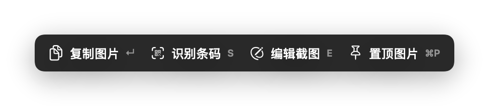
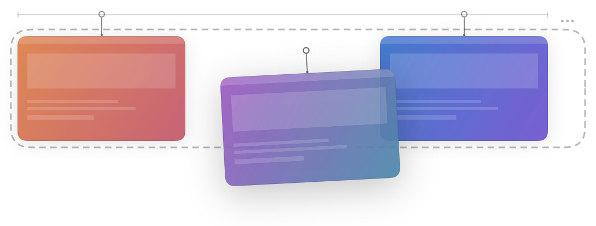
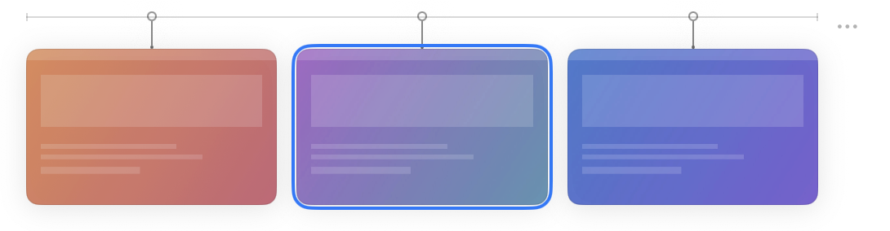
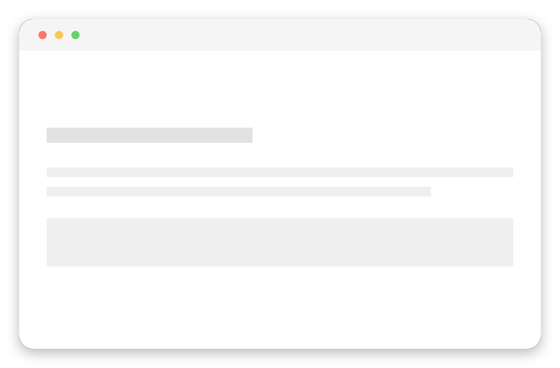

<h1 align="center">SnapGlass</h1>

<p align="center">
  <strong>离线优先 · 隐私优先 · macOS 截图、OCR 与录屏</strong>
</p>

<p align="center">
  <a href="https://github.com/blackkcold/snapocr/releases/latest">
    
  </a>
  <a href="https://github.com/blackkcold/snapocr/releases">
    
  </a>
  <a href="LICENSE">
    
  </a>
  <a href="https://www.apple.com/macos/">
    
  </a>
  <a href="https://swift.org">
    
  </a>
  <a href="https://github.com/blackkcold/snapocr/actions">
    
  </a>
</p>

<p align="center">
  <a href="https://github.com/blackkcold/snapocr/stargazers">
    
  </a>
</p>

<p align="center">
  <a href="#-下载">下载</a> ·
  <a href="#-三十秒上手">快速上手</a> ·
  <a href="#-功能">功能</a> ·
  <a href="#-使用场景">使用场景</a> ·
  <a href="#-快捷键">快捷键</a> ·
  <a href="#-构建">构建</a> ·
  <a href="CHANGELOG.md">更新日志</a> ·
  <a href="Docs/ARCHITECTURE.md">架构</a> ·
  <a href="Docs/PRIVACY.md">隐私</a>
</p>

---

<p align="center">
  
</p>

<p align="center"><sub>截图架：截图完成后按顺序挂起；拖动排序，拖出架体就是一个真实文件。</sub></p>

---

## 📥 下载

<p align="center">
  <a href="https://github.com/blackkcold/snapocr/releases/latest">
    
  </a>
</p>

前往 [Releases 页面](https://github.com/blackkcold/snapocr/releases) 下载：

- `SnapGlass-vX.Y.Z.dmg` — 安装包
- `SnapGlass-vX.Y.Z.dmg.sha256` — SHA-256 校验文件

> [!WARNING]
> 首次安装需在「系统设置 → 隐私与安全性」中允许打开（未签名应用）。
> 截图、录屏与滚动截图都需要「屏幕录制」权限。

---

## ⚡ 三十秒上手

1. 打开 DMG，把 **SnapGlass** 拖进「应用程序」。
2. 第一次打开若被系统拦截：系统设置 → 隐私与安全性 → **仍要打开**。
3. 授予「**屏幕录制**」权限——截图、滚动截图和录屏都依赖它。
4. 点菜单栏图标，或直接按 <kbd>⌘</kbd>+<kbd>⇧</kbd>+<kbd>1</kbd> 框选。

截图完成后，右下角动作栏会给出复制、编辑、置顶、识别条码等去向；最近几张会挂在**截图架**上等你下一步。

### 试一试

把 [`Docs/demo/ocr-sample.png`](Docs/demo/ocr-sample.png) 拖进 SnapGlass：里面有一个取件码、一个链接和一个邮箱，识别后应该直接出现「复制验证码」等动作。

---

## 🧰 功能

### 📸 截图

- 矩形区域、自由圈选、窗口、全屏、手动滚动截图（ScreenCaptureKit 主路径）
- 选区实时十字准线；**松开鼠标即出动作栏**，选区仍可拖动、八向缩放、方向键微调
- 支持多显示器与混合缩放；默认 Retina 像素，可切换标准 1x
- 输出 PNG / JPEG，JPEG 质量可调；透明内容强制 PNG

<p align="center">
  
</p>

<p align="center"><sub>选区松手后出现的动作栏，四个去向都带快捷键。</sub></p>

### 🗂 截图架

最近截图按完成顺序挂在屏幕边缘，随时取用：

- **拖动排序**：架内左右拖动即改变顺序，松手落位
- **拖出成文件**：把卡片拖出架体，立刻变成系统文件拖拽，可直接落进 Finder、浏览器上传区、微信 / 飞书 / Slack 等聊天窗口——不需要先右键复制
- **键盘模式**：菜单里的「键盘模式」打开后，<kbd>←</kbd><kbd>→</kbd> 选择、<kbd>↵</kbd> 复制、<kbd>空格</kbd> 进编辑器、<kbd>⌘</kbd>+<kbd>S</kbd> 另存为、<kbd>⌫</kbd> 移除、<kbd>Esc</kbd> 退出
- 卡片右键：编辑 / 复制 / 置顶 / 删除；数量、卡片高度、透明度、贴边位置可调，空闲可收成一条轨道

<p align="center">
  
</p>

<p align="center"><sub>架内拖动：圆角虚线标出排序区，松手落位；拖出架体就变成系统文件拖拽。</sub></p>

<p align="center">
  
</p>

<p align="center"><sub>键盘模式：← → 选择、↵ 复制、空格进编辑器、⌘S 另存为。</sub></p>

### 🪟 窗口截图美化

窗口截图默认带**圆角与柔和投影**，粘贴到文档或聊天里就是一张能直接发的图，不用再进编辑器加工。

- 投影与圆角按屏幕倍率等比生成
- 可在「设置 → 截图 → 图像」关闭
- 只在窗口截图生效；区域、全屏、滚动截图保持原始像素

<p align="center">
  
</p>

<p align="center"><sub>窗口截图默认带圆角与投影，粘贴到文档里就是一张能直接发的图。</sub></p>

### ✏️ 标注编辑器

- 8 种工具：箭头、矩形、文本、画笔、高亮、模糊、裁剪、取色器
- 完整撤销 / 重做；矩形默认线框，可显式填充
- 选择工具下能直接框选 OCR 文本，复制或转为标注
- 裁剪支持移动、缩放、确认后执行
- 取色器悬停显示 hex 与 RGB，单击复制单色，拖拽取区域平均色与主色；取色历史可在历史窗口的「颜色」分段网格浏览、按 hex 过滤

### 🔤 OCR

- Apple Vision 本地识别，完全离线；超大图自动分块并合并坐标
- 开发者模式可对比 Vision 与 Tesseract 双引擎
- 识别结果一键复制
- **智能动作**：识别到链接、邮箱或六位验证码时，提示条直接给出「打开 / 发邮件 / 复制验证码」，不用手动选中再复制

<p align="center">
  
</p>

<p align="center"><sub>识别到验证码 / 链接 / 邮箱时，提示条直接给出对应动作。</sub></p>

### 📦 条码

- QR / Code128 / EAN / PDF417 / Aztec / DataMatrix
- 选区动作栏按 <kbd>S</kbd> 直接识别，不进编辑器、不落历史
- 结果浮层可复制单条或全部，http(s) 链接一键打开；<kbd>R</kbd> 实时重截，能跟上动画码
- 截图后自动检测，一键复制内容

### 📌 置顶

- 选区阶段按 <kbd>⌘</kbd>+<kbd>P</kbd>，或点动作栏「置顶图片」
- 拖动移动；右下角等比缩放；滚轮 / 捏合缩放；<kbd>⌥</kbd>+滚轮调透明度
- 悬停出现工具条：不透明度、对数缩放滑杆（10%–800%）、1:1 与「适应屏幕」
- 右键可复制图片、复制文字（OCR）、适应屏幕、关闭全部
- 双击、<kbd>Esc</kbd> 或 <kbd>⌘</kbd>+<kbd>W</kbd> 关闭；置顶内容不会出现在录屏或后续截图里

### 🎥 屏幕录制

- 单显示器、单窗口、显示器内区域三种来源
- 可选编码与系统音频；输出 MP4
- 原子发布：先写临时文件，成功后才落盘，不会覆盖同名旧文件
- 录制中菜单栏显示状态，退出前会确认未保存的录制

### 🔐 隐私与存储

- 历史记录使用 **AES-256-GCM** 本地加密，密钥只存在本机
- 没有后台网络请求；只有你主动点「检查更新」时才会联网
- 不读取系统钥匙链；不采集遥测
- 截图架的明文本地副本只用于拖出文件，随卡片移除、清空与下次启动清理

---

## 🎯 使用场景

- 从**不可选中文本的 PDF**、视频会议共享屏、在线课程里提取文字
- 截图后**直接标注**发群，或**窗口截图直接美化**后贴进文档
- 识别截图里的**二维码与条码**并打开链接
- 把最近几张截图**拖进聊天窗口**，不用先保存到桌面
- 连续截图并自动 OCR 存档

---

## ⌨️ 快捷键

| 操作 | 快捷键 |
|------|--------|
| 区域截图 | <kbd>⌘</kbd> + <kbd>⇧</kbd> + <kbd>1</kbd> |
| 窗口截图 | <kbd>⌘</kbd> + <kbd>⇧</kbd> + <kbd>2</kbd> |
| 全屏截图 | <kbd>⌘</kbd> + <kbd>⇧</kbd> + <kbd>3</kbd> |
| OCR 识别 | <kbd>⌘</kbd> + <kbd>⇧</kbd> + <kbd>O</kbd> |
| 置顶当前选区 | <kbd>⌘</kbd> + <kbd>P</kbd> |
| 选区识别条码 | <kbd>S</kbd> |
| 条码重新截屏识别 | <kbd>R</kbd> |

截图架键盘模式（在架子的菜单里开启）：

| 操作 | 按键 |
|------|------|
| 选择上一张 / 下一张 | <kbd>←</kbd> / <kbd>→</kbd> |
| 复制 | <kbd>↵</kbd> |
| 打开编辑器 | <kbd>空格</kbd> |
| 另存为 | <kbd>⌘</kbd> + <kbd>S</kbd> |
| 移除 | <kbd>⌫</kbd> |
| 退出键盘模式 | <kbd>Esc</kbd> |

全局截图与 OCR 热键可在「设置 → 快捷键」中修改；置顶快捷键是选区上下文快捷键，不会注册为全局热键。

---

## 💻 系统要求

- macOS 13.0+
- Xcode 16+、Swift 6.0（构建）
- macOS 26+ 自动启用 Liquid Glass，低版本自动降级

---

## 🔧 构建

```bash
# 安装构建工具
brew install xcodegen swiftlint

# 生成 Xcode 工程
xcodegen generate

# 构建 Release 产物
./scripts/build.sh --version 1.3.1

# 本地实验打包：每次生成唯一目录，永不覆盖，用于多轮产物对比
./scripts/build.sh --experimental

# 构建后打开 Finder（产物统一输出到 release/vX.Y.Z/）
./scripts/build.sh --open

# 运行全量测试
./scripts/test.sh
```

> 构建产物统一归档到 `release/vX.Y.Z/`，不使用 `output/` 目录。详见 [`Docs/RELEASE.md`](Docs/RELEASE.md)。

---

## 📁 项目结构

```
SnapGlass/
├── App/SnapGlass/          # macOS GUI App
├── Packages/               # 核心功能模块（SPM）
│   ├── SharedKit/           # 共享工具（偏好、图像编码、加密、日志）
│   ├── CaptureCore/         # 截图（ScreenCaptureKit + CG 兼容）
│   ├── OCRCore/             # OCR（Vision + Tesseract 降级）
│   ├── BarcodeCore/         # 条码识别
│   ├── AnnotationCore/      # 标注工具集
│   ├── ScrollCore/          # 滚动截图拼接
│   ├── HistoryCore/         # 本地历史加密存储
│   └── AutomationCore/      # Automation 保留源码（不进入产品构建）
├── Docs/                    # 项目文档
├── scripts/                 # 构建与测试脚本
└── release/                 # 发版产物归档
```

---

## 📖 文档

| 文档 | 说明 |
|------|------|
| [架构设计](Docs/ARCHITECTURE.md) | 协议分层与模块设计 |
| [隐私声明](Docs/PRIVACY.md) | 数据处理与隐私保护 |
| [安全策略](Docs/SECURITY.md) | 安全边界与漏洞报告 |
| [贡献指南](Docs/CONTRIBUTING.md) | 代码规范与 PR 流程 |
| [发版流程](Docs/RELEASE.md) | 构建与发布规范 |
| [CI/CD 说明](Docs/CI.md) | GitHub Actions 工作流 |
| [更新日志](CHANGELOG.md) | 版本历史 |

---

## 🤝 贡献

欢迎贡献！请先阅读 [贡献指南](Docs/CONTRIBUTING.md)。

- **提交 PR**：标题遵循 [Conventional Commits](https://www.conventionalcommits.org/) 格式
- **报告问题**：使用 [GitHub Issues](https://github.com/blackkcold/snapocr/issues)
- **安全漏洞**：请通过 GitHub Issues 私下报告，勿公开披露

---

## 📄 许可证

[MIT License](LICENSE) © SnapGlass Contributors
